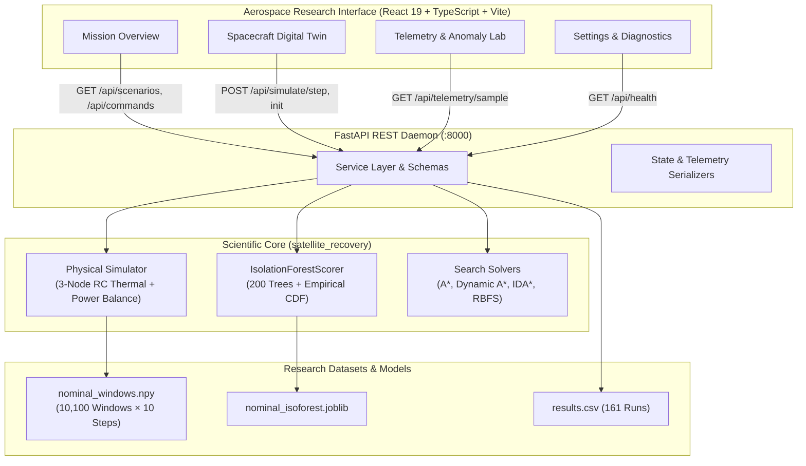

# Risk-Aware Dynamic A* for Satellite Anomaly Recovery

An autonomous decision-making and recovery architecture for spacecraft subsystems, combining discrete-time physical simulation, unsupervised Isolation Forest anomaly scoring, informed heuristic search, and an interactive aerospace research interface.

---

## 1. Executive Summary

Unsupervised machine learning models excel at detecting spacecraft telemetry deviations, but turning a detection into a **safe, multi-step recovery plan** is challenging. Purely predictive neural models risk hallucinating unphysical actions or violating thermal-electric safety margins.

This project formulates spacecraft anomaly recovery as an **informed state-space search**:
- **State Space**: Full subsystem representation comprising battery state-of-charge ($SoC \in [0, 1]$), 3-node thermal temperatures ($T_{\text{bat}}, T_{\text{bus}}, T_{\text{pay}}$ in °C), operating mode code, and subsystem relay states.
- **Action Space**: Discrete recovery commands (rebooting subsystems, load shedding, solar array slewing, safe-mode transitions) with execution latency and energy costs.
- **Goal Condition**: Any valid state where all temperatures and electrical margins return safely inside nominal operating limits.
- **Risk Guidance**: An unsupervised **Isolation Forest scorer** evaluates simulated states generated during search expansion, adding a continuous risk penalty $\lambda \cdot R(n)$ to steer pathfinding away from catastrophic operational envelopes.

> **Research Philosophy:** Machine learning only *evaluates* states; classical, deterministic, verifiable heuristic search algorithms *choose* the recovery actions.

---

## 2. System Architecture



---

## 3. Repository Structure

```
satellite-anomaly-recovery/
├── backend/                        # FastAPI REST API backend service
│   ├── main.py                     # API router, CORS middleware, route handlers
│   ├── schemas.py                  # Pydantic v2 validation and response schemas
│   ├── serializers.py              # Serialization helpers for simulator states
│   └── services.py                 # Core business logic, dataset reader, scorer adapter
├── frontend/                       # Interactive Aerospace Research Interface
│   ├── src/
│   │   ├── api/                    # Typed API client and TypeScript definitions
│   │   ├── components/             # Reusable UI components
│   │   │   ├── common/             # Metric cards, status badges, alerts, spinners
│   │   │   ├── digitaltwin/        # 3-node thermal schematic, power panel, console
│   │   │   ├── layout/             # Sidebar navigation, top header bar, app shell
│   │   │   └── telemetry/          # Multi-channel chart, window explorer, score card
│   │   ├── pages/                  # Top-level view pages
│   │   │   ├── MissionOverview.tsx # Project briefing, asset verification, scenarios
│   │   │   ├── DigitalTwin.tsx     # Spacecraft physical simulation & command console
│   │   │   ├── TelemetryLab.tsx    # 10,100 window explorer & anomaly investigation
│   │   │   └── SettingsStatus.tsx  # API diagnostics, environment verification
│   │   └── index.css               # Tailwind CSS v4 design tokens and Inter typography
├── satellite_recovery/             # Python algorithmic research package
│   ├── simulator/
│   │   ├── orbit.py                # OrbitSchedule: raised-cosine LEO solar flux model
│   │   ├── spacecraft.py           # SpacecraftState, SpacecraftParams, Simulator
│   │   ├── commands.py             # 8 discrete recovery actions (preconditions, effects)
│   │   └── faults.py               # Canonical fault profiles & injection mechanisms
│   ├── search/
│   │   ├── problem.py              # RecoveryProblem, Node, SearchResult definitions
│   │   ├── heuristics.py           # Admissible goal distance h_d + dynamic variants H0–H4
│   │   ├── astar.py                # DynamicAStar implementation (batched scoring)
│   │   ├── idastar.py              # Iterative Deepening A* (linear memory)
│   │   ├── rbfs.py                 # Recursive Best-First Search
│   │   └── local_search.py         # Hill Climbing & Simulated Annealing baselines
│   ├── anomaly/
│   │   ├── features.py             # Window → 32-dim feature vector (mean/std/slope/last)
│   │   └── scorer.py               # IsolationForestScorer + Empirical CDF calibration
│   └── evaluation/
│       ├── metrics.py              # Solution cost, safety margin, expansion metrics
│       └── scenarios.py            # Canonical evaluation scenarios (thermal, ADCS, cascades)
├── experiments/                    # Research datasets, model artifacts, and scripts
│   ├── data/                       # nominal_windows.npy (10,100 nominal windows)
│   ├── scorers/                    # nominal_isoforest.joblib (trained 200-tree model)
│   ├── results/                    # results.csv (161 evaluated benchmark runs)
│   ├── generate_nominal_data.py    # Training dataset generation pipeline
│   ├── train_scorer.py             # Scorer training & calibration script
│   └── run_experiment.py           # Head-to-head benchmarking execution harness
├── reports/                        # Verification, audit, and phase completion reports
│   ├── phase3_frontend_audit.md    # Frontend architecture baseline
│   ├── phase4_digital_twin_audit.md# Digital Twin simulator audit
│   ├── phase5_telemetry_audit.md   # Telemetry dataset & scoring audit
│   ├── phase5_completion_report.md # Phase 5 verification record
│   ├── ui_refinement_audit.md      # UI design system audit
│   └── ui_refinement_completion_report.md # UI refinement record
└── tests/                          # Automated backend pytest suite (40 tests)
```

---

## 4. Web Application Features

### 4.1 Mission Overview (`/`)
- **Executive Research Briefing**: Explains the core problem formulation, state-space search mechanics, and evaluation parameters in clear technical terms.
- **Workspace Launchers**: Quick-access interactive cards providing direct entry into the Spacecraft Digital Twin and Telemetry Lab.
- **Read-Only Asset Verification**: Confirms presence and integrity of `nominal_isoforest.joblib`, `nominal_windows.npy`, and `results.csv`.
- **Audited Limitations Disclosure**: Dedicated expandable panel documenting codebase characteristics, including the known H3 double-risk formulation and discrete hash coarsening bounds.
- **Canonical Scenarios & Commands**: Live, interactive tables displaying fault profiles, orbital solar phases ($\phi$), command latency, and energy costs.

### 4.2 Spacecraft Digital Twin (`/digital-twin`)
- **Three-Node Thermal Schematic**: Visualizes the lumped-parameter conductive RC network across **Battery Pack** (Node 1), **Electronics Bus** (Node 3), and **Science Payload** (Node 2).
- **Physical Safety Margins**: Instant visual classification into Nominal, Out-of-Band Warning, or Hard Constraint Violation states.
- **Collapsible Model Details**: Secondary parameters ($C_{\text{bat}}, C_{\text{bus}}, C_{\text{pay}}$, deep space sink $-90.0\ ^\circ\text{C}$, conductive conductances $UA$) are housed in an expandable drawer to keep core temperatures prominent.
- **Subsystem Power Balance**: Evaluates solar generation against avionics, payload, heater, and transmitter electrical loads.
- **Interactive Command Console**: Dispatches validated recovery commands (`reboot_subsystem`, `load_shedding`, `slew_sun`, `enter_safe_mode`, etc.), tracking cumulative step costs and safety margins.
- **Telemetry Charts**: Real-time multi-variable time series plotting temperature and state-of-charge trajectories using Recharts.

### 4.3 Telemetry & Anomaly Lab (`/telemetry-lab`)
- **Real Dataset Connection**: Directly queries `GET /api/telemetry/sample` reading the 10,100 nominal windows in `nominal_windows.npy` via read-only memory mapping.
- **Reproducible Seed Sampling**: Supports direct numerical window index retrieval ($0 \le i < 10100$) and deterministic pseudo-random seed sampling.
- **Multichannel Time Series**:
  - Continuous physical channels (`soc`, `temp_battery`, `temp_payload`, `temp_bus`) plotted with smooth curves.
  - Discrete subsystem relays (`heater_on`, `payload_on`, `transmitter_on`) and operating modes (`mode_code`) plotted with stepped geometry (`type="stepAfter"`).
- **Calibrated Anomaly Scoring**: Displays the real empirical CDF percentile rank ($R(n) \in [0, 1]$) computed on-the-fly by the trained `IsolationForestScorer` over 32 rolling statistical features.
- **Batch Comparison View**: Enables multi-window sampling ($1 \le n \le 10$), score distribution bar charts, and sample-level aggregations.

### 4.4 Settings & Diagnostics (`/settings`)
- Live backend connection testing with millisecond ping measurement.
- Runtime environment details (Python version, FastAPI application version, Vite proxy route).
- Read-only asset file verification and backend-reported implementation disclosures.

---

## 5. Getting Started

### Prerequisites
- **Python**: 3.11+ (virtual environment recommended)
- **Node.js**: v20+ (tested on Node v24 / npm v11)

### Quick Installation

1. **Clone the repository**:
   ```bash
   git clone https://github.com/Meet-Shah10/satellite-anomaly-recovery.git
   cd satellite-anomaly-recovery
   ```

2. **Set up the Python environment**:
   ```bash
   python -m venv .venv
   # Windows:
   .\.venv\Scripts\activate
   # Linux/macOS:
   source .venv/bin/activate

   pip install -e .
   pip install -r requirements.txt  # includes fastapi, uvicorn, scikit-learn, joblib, pytest
   ```

3. **Install frontend dependencies**:
   ```bash
   cd frontend
   npm install
   cd ..
   ```

---

## 6. Running the Application

Launch the backend and frontend in separate terminals:

### Terminal 1: FastAPI Backend Daemon
From the repository root:
```powershell
$env:PYTHONUTF8="1"; .\.venv\Scripts\python.exe -m uvicorn backend.main:app --host 127.0.0.1 --port 8000 --reload
```
- **Backend API**: `http://127.0.0.1:8000`
- **Swagger Documentation**: `http://127.0.0.1:8000/docs`

### Terminal 2: Vite Aerospace Frontend
From the `frontend/` directory:
```powershell
cd frontend
npm run dev
```
- **Web Interface**: `http://localhost:5173/`

---

## 7. CLI Experiments & Algorithm Benchmarking

In addition to the interactive web application, the repository provides full CLI harnesses for reproducing the published research benchmarks:

### Run a Single Solver Experiment
```bash
python experiments/run_experiment.py \
    --scenario single_thermal \
    --algorithm astar \
    --variant H2 \
    --lambda-risk 50 \
    --seed 0 \
    --scorer experiments/scorers/nominal_isoforest.joblib \
    --output experiments/results/results.csv
```

### Full Benchmark Sweep
Executes all canonical scenarios across all algorithms (A*, Dynamic A*, Weighted A*, Greedy Best-First, Hill Climbing, Simulated Annealing) over 10 random seeds:
```bash
python experiments/run_experiment.py \
    --sweep \
    --seeds 10 \
    --scorer experiments/scorers/nominal_isoforest.joblib
```

---

## 8. Verification & Test Suite

The codebase maintains strict automated test coverage across physical simulation, search solvers, anomaly scoring, and REST API contracts:

```powershell
# Run backend regression tests (40 passed tests)
$env:PYTHONUTF8="1"; .\.venv\Scripts\python.exe -m pytest -q

# Run frontend linter (0 warnings, 0 errors)
cd frontend
npm run lint

# Run frontend production build
npm run build
```

---

## 9. Scientific Rigor & Known Research Characteristics

1. **No Fabricated Telemetry**: Every measurement, temperature, and power curve shown in the web interface is computed dynamically by the discrete-time physics simulator or read directly from the nominal reference dataset.
2. **Heuristic Formulation H3 (Preserved Finding)**: During codebase audit, it was confirmed that variant H3 folds risk into both edge cost $g(n)$ and heuristic estimate $h(n)$ simultaneously. In strict adherence to scientific replication standards, this formulation is preserved and explicitly disclosed in the interface.
3. **Calibrated Score Meaning**: Anomaly scores $R(n)$ represent continuous empirical CDF percentile ranks relative to nominal baseline data. The platform explicitly disclaims universal binary classification thresholds (e.g., 0.5 or 0.8) and does not present an anomaly score as definitive proof of physical hardware failure.
4. **Thermal Modeling Assumptions**: Thermal behavior is modeled via an isothermal 3-node lumped RC network integrated with discrete 60s Euler time-steps with raised-cosine solar illumination.
